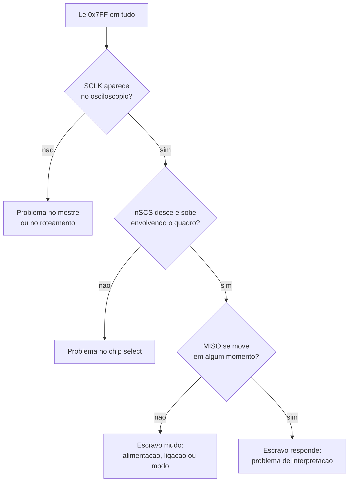

# Estudo — SPI aplicado ao DRV8353RS

> [!abstract] Objetivo verificável
> Ler de volta um registrador do DRV8353RS com valor conhecido **e justificar
> cada escolha do barramento** — polaridade e fase do clock, ordem dos bits,
> largura do quadro, frequência, comportamento do chip select — apontando a
> figura ou tabela do datasheet que sustenta cada uma.
>
> "Funcionou" não é o critério. O critério é saber por que funcionou.

Contexto do projeto: [[ESC Checkpoint]] · [[ESC Guia do Código]]

> [!warning] Regra desta trilha
> Não busque a resposta por tentativa e erro nos quatro modos SPI. Testar os
> quatro leva dez minutos e resolve hoje; deduzir do diagrama de temporização
> leva uma hora e resolve para sempre. Você vai encontrar o mesmo problema em
> cada periférico SPI da sua carreira.

## Bloco 1 — O modelo mental: registrador de deslocamento

O erro conceitual mais comum em SPI é pensá-lo como "envio de bytes". Não é.
SPI é um **anel de deslocamento**: mestre e escravo têm cada um um registrador,
ligados em circuito fechado, e cada pulso de clock desloca um bit de cada lado.

Consequência direta, que quase todo iniciante estranha: **não existe "só ler".**
Toda leitura é simultaneamente uma escrita, e toda escrita é simultaneamente
uma leitura.

- [ ] Estudar o modelo do registrador de deslocamento duplo
- [ ] Identificar os quatro sinais e o papel de cada um
- [ ] Entender por que o escravo só pode responder enquanto o mestre gera clock

> [!question] Critério de domínio do bloco 1
> Explicar, em duas frases, por que no código existe uma transferência "vazia"
> quando você quer apenas ler um registrador — e o que o DRV faz com os bits
> que você mandou nessa transferência.

**Onde estudar:** o capítulo de SPI do RM0440 (reference manual do STM32G4)
tem o diagrama do anel de deslocamento na abertura da seção. É a fonte mais
próxima do seu hardware.

## Bloco 2 — CPOL e CPHA: de onde saem os quatro modos

Duas decisões independentes geram quatro combinações:

- **CPOL** — o nível do clock quando ocioso
- **CPHA** — se o dado é amostrado na primeira ou na segunda transição do clock

O que importa não é decorar a tabela dos quatro modos. É saber **extrair a
combinação certa de um diagrama de temporização**, que é a habilidade que
transfere para qualquer chip.

- [ ] Entender o significado físico de cada bit, não a tabela
- [ ] Aprender a ler, num diagrama, em que borda o dado é estável
- [ ] Entender por que amostrar na borda errada lê o bit anterior ou ruído

> [!question] Critério de domínio do bloco 2
> Pegar um diagrama de temporização SPI de um chip **qualquer** — não o
> DRV8353 — e determinar o modo. Depois justificar: "o dado é amostrado nesta
> borda, logo CPHA é X; o clock repousa neste nível, logo CPOL é Y."

> [!tip] Truque para ler o diagrama
> Procure as setas verticais ou marcadores que o fabricante desenha sobre as
> bordas do clock. Elas indicam o instante de amostragem. A pergunta a fazer
> é: *nesse instante, o dado já está estável há quanto tempo?*

## Bloco 3 — O quadro do DRV8353RS

Aqui você sai do genérico e entra no chip específico. O DRV usa um quadro de
tamanho fixo com campos posicionais.

- [ ] Localizar a seção de interface SPI no datasheet (é anterior à seção de
      mapa de registradores, que você já usou)
- [ ] Identificar a largura do quadro e o que ocupa cada faixa de bits
- [ ] Determinar o modo SPI a partir do diagrama de temporização **do DRV**
- [ ] Identificar a frequência máxima de SCLK
- [ ] Entender o que o chip exige do nSCS entre quadros
- [ ] Verificar a condição de alimentação para o SPI responder

> [!question] Critério de domínio do bloco 3
> Escrever **à mão, no papel**, os 16 bits de um quadro que lê o registrador
> `0x06`. Depois converter para hexadecimal. Só então comparar com o que o seu
> código monta em `readReg()`.
>
> Se os dois baterem, seu código está certo e o problema é elétrico ou de
> configuração. Se divergirem, você achou o bug sem osciloscópio nenhum.

> [!warning] Este é o bloco que provavelmente resolve seu problema atual
> Faça-o antes de ligar o osciloscópio. Papel e datasheet são mais rápidos que
> bancada.

## Bloco 4 — Instrumentação: ver o barramento

Você tem osciloscópio de 2 canais. Isso basta, mas exige escolher os pares
certos, um de cada vez.

- [ ] Capturar SCLK e nSCS — verificar o envelope do quadro
- [ ] Capturar SCLK e MOSI — verificar o que o MCU está mandando
- [ ] Capturar SCLK e MISO — verificar se o DRV responde alguma coisa
- [ ] Medir a frequência real do SCLK e comparar com a configurada

> [!question] Critério de domínio do bloco 4
> Numa captura de SCLK com MOSI, **contar os pulsos de clock** e **ler os bits
> à mão** da forma de onda. Reconstruir o valor e compará-lo com o que você
> escreveu no papel no bloco 3.

> [!tip] Use o nSCS como disparo
> Disparar na borda de descida do nSCS estabiliza a captura no início do quadro.
> Sem isso a tela fica instável e você não consegue contar bits.

**Onde estudar:** a seção de trigger do manual do seu osciloscópio. Ferramenta
mal usada é a causa mais comum de "não consegui ver nada".

## Bloco 5 — Diagnóstico estruturado

Com os blocos anteriores, você consegue localizar a falha por região em vez de
trocar parâmetros ao acaso.

- [ ] Percorrer a árvore com medidas, não com suposições
- [ ] Para cada nó, anotar a evidência que fechou a decisão

> [!question] Critério de domínio do bloco 5
> Conseguir dizer **em qual nó da árvore o seu sistema está**, com uma captura
> de osciloscópio que sustente a afirmação.

## Bloco 6 — Transferência

O domínio se comprova fora do problema original.

- [ ] Explicar o que aconteceria se o SCLK estivesse duas vezes mais rápido que
      o máximo do chip — e por que o sintoma seria diferente de um modo errado
- [ ] Prever o que MISO mostraria com o escravo **sem alimentação**, e explicar
      por que
- [ ] Explicar por que `0x000` e `0x7FF` são valores suspeitos, e o que os
      diferencia como pista

## Registro de progresso

| Bloco | Concluído em | Evidência |
| ----- | ------------ | --------- |
| 1     |              |           |
| 2     |              |           |
| 3     |              |           |
| 4     |              |           |
| 5     |              |           |
| 6     |              |           |
