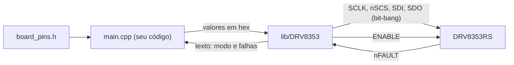
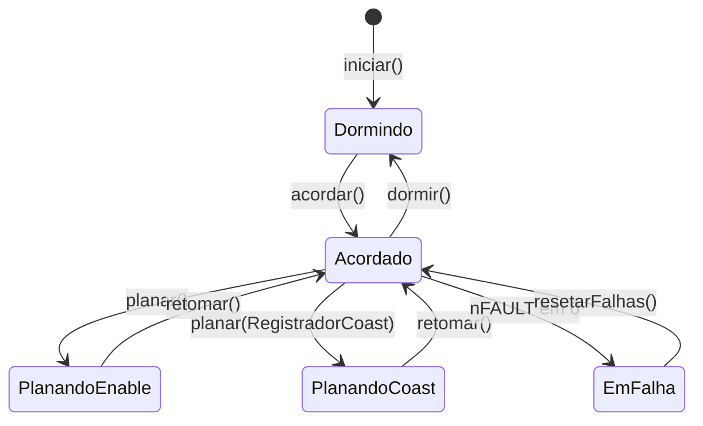

# Biblioteca DRV8353 — guia de uso e reaproveitamento da firmware_foc

## Escopo

**Cobre:** o que a biblioteca [`lib/DRV8353`](../lib/DRV8353/DRV8353.h) faz e como usar cada função; como montar e ler o valor de cada registrador; o significado das falhas; o modo planar; as regras de segurança que o código assume; e o caminho para levar a biblioteca a um projeto novo, inclusive trocando o driver antigo da `firmware_foc/`.

**Não cobre:** o dimensionamento do gate drive e da proteção para um MOSFET específico, a geração de PWM (TIM1), os halls, a malha de controle (M3 a M8 do roadmap) e a configuração interna da SimpleFOC, exceto nos pontos de contato com o driver.

> [!NOTE] Estado de validação em 2026-10-16
> Validado em bancada: transporte SPI e despertar (300 ciclos `dormir` → `acordar` sem falha de conferência). A versão 2.0 reescreveu a camada de cima (registradores em hex, explicação em texto, falhas, reset e modo planar): compila sem avisos com `-Wall -Wextra`, mas **ainda não rodou na placa**. Ver Pendências.

## Visão geral

A classe `DRV8353` controla o gate driver DRV8353RS (TI, SLVSDY6A). Ela é organizada em seis operações: acordar, passar valores de registrador, ler e explicar registradores, ler e explicar falhas, resetar falhas e planar. Por baixo, fala SPI por **bit-bang**, porque a ERRATA 001 (MOSI e MISO trocados na Ouroboros) impede o SPI de hardware.



| Arquivo | Conteúdo |
|---|---|
| `lib/DRV8353/DRV8353.h` | API pública, `DrvPinos`, `DrvFalhas`, `ModoPlanar` e `MetodoReset` |
| `lib/DRV8353/DRV8353_regs.h` | endereços (`DRV_REG_*`), bits, máscaras de falha e valores de reset |
| `lib/DRV8353/DRV8353.cpp` | transporte, escrita conferida, falhas, planar e a explicação em texto |
| `include/board_pins.h` | pinos da placa; fica **fora** da biblioteca de propósito, para ela não conhecer a placa |
| `src/main.cpp` | em branco: o seu código |
| `testes/08_bancada_drv8353.cpp` | console de bancada que usa todas as funções; serve de exemplo |

> [!WARNING] Nunca no laço de corrente
> Uma transação SPI leva cerca de 130 µs (meça com o comando `t` do console) e o período de uma malha a 20 kHz é 50 µs. Nenhuma função da biblioteca pode ser chamada de dentro dela. A falha rápida vem do `nFAULT` como GPIO ou EXTI.

## Início rápido

```cpp
#include <Arduino.h>
#include <DRV8353.h>
#include "board_pins.h"

HardwareSerial Dbg(CONSOLE_RX, CONSOLE_TX);

DRV8353 drv({ DRV_PINO_SCLK, DRV_PINO_NSCS, DRV_PINO_SDI,
              DRV_PINO_SDO,  DRV_PINO_ENABLE, DRV_PINO_NFAULT });

void setup()
{
    analogReadResolution(12);
    Dbg.begin(CONSOLE_BAUD);

    drv.iniciar();                                            // driver dormindo
    drv.escreverRegistrador(DRV_REG_DRIVER_CONTROL, 0x100);   // GDF desligado: só em bancada
    drv.escreverRegistrador(DRV_REG_CSA_CONTROL,    0x2C3);   // ganho 40 V/V

    if (!drv.acordar()) {                                     // escreve e confere tudo
        drv.mostrarFalhas(Dbg);                               // não ligue o PWM
        return;
    }
    drv.mostrarRegistradores(Dbg);                            // lê e explica
}

void loop() {}
```

A ordem é sempre a mesma: `iniciar()` → passar os valores → `acordar()` → conferir o retorno. O que você não passar fica no valor de reset do chip. No exemplo, `0x2C3` é o reset do CSA (`0x283`) com o ganho trocado de 20 para 40 V/V; a seção "Montar o valor de um registrador" mostra como chegar nele.

## As seis operações

| Operação | Função | Retorno e observações |
|---|---|---|
| Preparar | `iniciar()` | nSCS alto, ENABLE baixo: driver dormindo. Chame primeiro |
| Acordar | `acordar()` | ENABLE alto, espera 1,5 ms, escreve e confere os seis registradores. `true` só se tudo conferiu **e** o nFAULT está alto. Cerca de 3,1 ms |
| | `dormir()` | ENABLE baixo. Desligue o PWM antes |
| | `acordado()` | Estado do ENABLE. Não prova que a configuração conferiu |
| Passar valor | `escreverRegistrador(reg, valor)` | Guarda o valor. Acordado, escreve e confere (`true` se conferiu); dormindo, só guarda e vale no próximo `acordar()`. `false` para 0x00, 0x01 ou acima de 0x07 |
| | `valorConfigurado(reg)` | O valor guardado, já com os ajustes da tabela abaixo |
| | `registradoresDivergentes()` | Máscara: bit n ligado = o registrador 0x0n não conferiu |
| Ler e explicar | `lerRegistrador(reg)` | 11 bits crus. Com o chip dormindo não há resposta |
| | `mostrarRegistradores(saida)` | Lê os oito, explica cada campo, marca `ok` ou `DIFERENTE do configurado` e resume o modo. Dormindo, explica os valores guardados |
| | `DRV8353::explicarRegistrador(saida, reg, valor)` | Explica um valor **sem tocar no chip**: confira o hex antes de escrever |
| Falhas | `emFalha()` | Nível do nFAULT (`true` com o pino em 0) |
| | `lerFalhas()` | `DrvFalhas` com os registradores crus e campos com nome |
| | `mostrarFalhas(saida)` | Cada falha ativa com o que é e a causa provável |
| Resetar | `resetarFalhas(metodo)` | `true` se o nFAULT subiu. Os dois métodos mantêm a configuração |
| Planar | `planar(modo)` | Abre todos os MOSFETs |
| | `retomar()` | Desfaz pelo mesmo caminho. `true` se o driver ficou pronto para o PWM |
| | `planando()` | Estado do planar |
| CSAs | `iniciarAutoZero()`, `terminarAutoZero()` | Curto nas entradas dos amplificadores para medir o offset |

### Acordar e dormir

O sono apaga todos os registradores do chip. Por isso a biblioteca **guarda** os valores que você passa e os reescreve e confere a cada `acordar()`. O tWAKE do datasheet é de no máximo 1 ms (SLVSDY6A, §7.5); a biblioteca espera 1,5 ms com `delayMicroseconds`, porque o `delay(1)` do Arduino pode esperar quase nada e foi a causa do `FALHOU` intermitente.

O `acordar()` também confere o nível do `nFAULT`: uma falha que surge durante o despertar não gera borda nova para a interrupção, e só a leitura do nível a pega.



### Passar valores de registrador

```cpp
drv.escreverRegistrador(DRV_REG_GATE_DRIVE_HS, 0x344);   // IDRIVEP 300 mA, IDRIVEN 600 mA
```

Os endereços são as constantes `DRV_REG_DRIVER_CONTROL` (0x02), `DRV_REG_GATE_DRIVE_HS` (0x03), `DRV_REG_GATE_DRIVE_LS` (0x04), `DRV_REG_OCP_CONTROL` (0x05), `DRV_REG_CSA_CONTROL` (0x06) e `DRV_REG_DRIVER_CONFIG` (0x07). Os registradores 0x00 e 0x01 são só de leitura.

Ao guardar, a biblioteca ajusta o que o chip ignoraria ou mudaria sozinho. Sem isso, a releitura acusaria uma divergência que não é falha:

| Registrador | Ajuste | Por quê |
|---|---|---|
| 0x02 | `CLR_FLT` não é guardado | É um pulso: o chip zera o bit sozinho |
| 0x03 | `LOCK` sempre em 011b | Travar faria o chip ignorar as escritas seguintes do despertar |
| 0x06 | `CSA_CAL_A/B/C` não são guardados | O curto do auto-zero voltaria a cada despertar |
| 0x06 | `CSA_FET = 1` liga também `LS_REF` | O chip faz isso sozinho |
| 0x07 | Bits 10 a 1 zerados | São reservados |

### Ler e explicar

`mostrarRegistradores(Dbg)` imprime, para cada registrador, o valor em hex, se ele bate com o configurado e cada campo em unidades físicas. No fim vem uma linha de resumo do modo (PWM, OCP, tempo morto, ganho do CSA) e avisos quando gate drive, OCP e CSA ainda estão no reset ou quando o GDF está desligado.

Para conferir um valor antes de escrevê-lo, sem precisar do chip:

```cpp
DRV8353::explicarRegistrador(Dbg, DRV_REG_OCP_CONTROL, 0x225);
```

### Ler falhas e saber a causa

```cpp
const DrvFalhas f = drv.lerFalhas();
if (f.sobrecorrente_vds || f.desligamento_termico) {
    // sua reação: desligar o PWM, registrar, avisar o piloto
}
drv.mostrarFalhas(Dbg);          // texto com a causa provável
drv.resetarFalhas();             // por SPI; MetodoReset::PulsoEnable não usa o barramento
```

| Campo de `DrvFalhas` | Bit |
|---|---|
| `valida` | `false` com o driver dormindo: nada foi lido |
| `status1`, `status2` | 0x00 e 0x01 crus |
| `alguma` | FAULT |
| `sobrecorrente_vds` | VDS_OCP |
| `falha_gate` | GDF |
| `subtensao_vm` | UVLO |
| `desligamento_termico` | OTSD |
| `aviso_temperatura` | OTW |
| `subtensao_gate` | GDUV |
| `sobrecorrente_shunt` | SA_OC, SB_OC ou SC_OC |

O que `mostrarFalhas()` diz de cada uma:

| Falha | O que é | Causa provável |
|---|---|---|
| VDS_OCP | A queda VDS de um MOSFET ligado passou do limiar | Curto na fase ou no motor, corrente alta, ou `VDS_LVL` e `OCP_DEG` apertados (0x05) |
| GDF | A VGS de um MOSFET não chegou ao nível esperado | MOSFET ausente ou gate aberto, gate em curto, ou IDRIVE e TDRIVE fracos (0x03, 0x04) |
| UVLO | A alimentação VM caiu abaixo do limite | Fonte desligada ou fraca, bateria baixa, mau contato em VM |
| OTSD | O chip passou da temperatura máxima e desligou | Dissipação alta no driver; esperar esfriar antes de resetar |
| SA_OC, SB_OC, SC_OC | Tensão no shunt da fase acima de `SEN_LVL` | Corrente alta na fase ou `SEN_LVL` baixo demais (0x06) |
| OTW | Aviso de temperatura alta; o driver continua operando | Dissipação alta; se subir mais, vira OTSD |
| GDUV | Subtensão da bomba de carga (VCP) ou do regulador do low-side (VGLS) | VM baixo ou consumo de gate alto demais |

Além disso ela lista **quais MOSFETs** acusaram (bits `VDS_xx` e `VGS_xx`), avisa quando só o low-side acusa (olhar MOSFETs e shunts: o monitor do low-side se referencia em SPx), avisa quando o nFAULT está em 0 sem nenhum bit de falha (pull-up ou jumper J7) e lembra que, com o OCP em modo trava, a ponte só volta com `resetarFalhas()`.

### Resetar falhas

| Método | Como | Quando usar |
|---|---|---|
| `MetodoReset::Spi` (padrão) | Escreve `CLR_FLT` no 0x02 | Uso normal |
| `MetodoReset::PulsoEnable` | Pulso de 20 µs no ENABLE (tRST de 5 a 40 µs) | SPI sem resposta: não depende do barramento |

Os dois mantêm a configuração. O retorno é `true` se o nFAULT subiu; se a causa continuar presente, ele volta a cair.

### Modo planar

`planar()` abre todos os MOSFETs, e `retomar()` desfaz pelo mesmo caminho. Há dois jeitos de abrir a ponte:

| | `planar()` = `ModoPlanar::PinoEnable` | `planar(ModoPlanar::RegistradorCoast)` |
|---|---|---|
| Como | ENABLE em 0: o chip dorme | Bit `COAST` no 0x02: ponte em alta impedância |
| Consumo do driver | ~20 µA (1 mW a 48 V) | ~10,4 mA (500 mW a 48 V) |
| Registradores | Apagados; `retomar()` reescreve e confere (~3,1 ms) | Mantidos; `retomar()` só limpa o `COAST` (~0,3 ms) |
| Usa o SPI | Só no `retomar()` | Nos dois sentidos |
| PWM do MCU | **Precisa** estar parado antes | A ponte ignora as entradas, mas pare mesmo assim para não voltar com razão cíclica velha |
| Proteções do chip durante o planeio | Desligadas com o chip | Ativas |

**Recomendação:** use o padrão `PinoEnable` no planeio do veículo. O cubo de roda livre deixa o motor parado na inércia, e o sono economiza cerca de 0,5 W; é a arquitetura descrita no README. `RegistradorCoast` serve para pausas curtas, em que os 3 ms de retomada pesam, e para testar em bancada sem perder a configuração.

```cpp
pwmDesligar();                    // seu código: PWM parado antes
drv.planar();                     // padrão: pelo ENABLE
// ... planeio ...
if (drv.retomar()) {              // acorda, reescreve e confere
    zerarIntegradores();
    pwmLigar();                   // por último
}
```

## Montar o valor de um registrador

Cada registrador tem 11 bits, escritos com três dígitos hex: o primeiro dígito leva os bits 10 a 8, o segundo os bits 7 a 4 e o terceiro os bits 3 a 0. Os campos de cada dígito, do bit mais alto para o mais baixo (SLVSDY6A, §8.6.2):

| Registrador | 1º dígito (bits 10–8) | 2º dígito (bits 7–4) | 3º dígito (bits 3–0) | Reset |
|---|---|---|---|---|
| 0x02 DRIVER_CONTROL | OCP_ACT, DIS_GDUV, DIS_GDF | OTW_REP, PWM_MODE (2 bits), 1PWM_COM | 1PWM_DIR, COAST, BRAKE, CLR_FLT | `0x000` |
| 0x03 GATE_DRIVE_HS | LOCK (3 bits) | IDRIVEP_HS | IDRIVEN_HS | `0x3FF` |
| 0x04 GATE_DRIVE_LS | CBC, TDRIVE (2 bits) | IDRIVEP_LS | IDRIVEN_LS | `0x7FF` |
| 0x05 OCP_CONTROL | TRETRY, DEAD_TIME (2 bits) | OCP_MODE (2 bits), OCP_DEG (2 bits) | VDS_LVL | `0x16D` |
| 0x06 CSA_CONTROL | CSA_FET, VREF_DIV, LS_REF | CSA_GAIN (2 bits), DIS_SEN, CSA_CAL_A | CSA_CAL_B, CSA_CAL_C, SEN_LVL (2 bits) | `0x283` |
| 0x07 DRIVER_CONFIG | reservado | reservado | reservado, CAL_MODE | `0x000` |

Campos de 4 bits: o dígito inteiro é o código.

| Código | IDRIVEP (mA) | IDRIVEN (mA) | VDS_LVL (V) |
|---|---|---|---|
| 0 | 50 | 100 | 0,06 |
| 1 | 50 | 100 | 0,07 |
| 2 | 100 | 200 | 0,08 |
| 3 | 150 | 300 | 0,09 |
| 4 | 300 | 600 | 0,1 |
| 5 | 350 | 700 | 0,2 |
| 6 | 400 | 800 | 0,3 |
| 7 | 450 | 900 | 0,4 |
| 8 | 550 | 1100 | 0,5 |
| 9 | 600 | 1200 | 0,6 |
| A | 650 | 1300 | 0,7 |
| B | 700 | 1400 | 0,8 |
| C | 850 | 1700 | 0,9 |
| D | 900 | 1800 | 1 |
| E | 950 | 1900 | 1,5 |
| F | 1000 | 2000 | 2 |

Campos de 2 bits:

| Campo | 00 | 01 | 10 | 11 |
|---|---|---|---|---|
| PWM_MODE (0x02) | 6x | 3x | 1x | independente |
| TDRIVE (0x04) | 500 ns | 1000 ns | 2000 ns | 4000 ns |
| DEAD_TIME (0x05) | 50 ns | 100 ns | 200 ns | 400 ns |
| OCP_MODE (0x05) | trava | retry | só reporta | desligado |
| OCP_DEG (0x05) | 1 µs | 2 µs | 4 µs | 8 µs |
| CSA_GAIN (0x06) | 5 V/V | 10 V/V | 20 V/V | 40 V/V |
| SEN_LVL (0x06) | 0,25 V | 0,5 V | 0,75 V | 1 V |

Campos de 1 bit:

| Campo | 0 | 1 |
|---|---|---|
| OCP_ACT (0x02) | Sobrecorrente desliga só o meio-braço em falha | Desliga os três |
| DIS_GDUV (0x02) | Falha GDUV ativa | Desligada |
| DIS_GDF (0x02) | Falha GDF ativa | Desligada (só em bancada) |
| OTW_REP (0x02) | Aviso térmico fora do nFAULT | Aviso térmico no nFAULT |
| 1PWM_COM (0x02) | Retificação síncrona (modo 1x) | Assíncrona |
| COAST (0x02) | Normal | Todos os MOSFETs abertos |
| BRAKE (0x02) | Normal | Os três low-side ligados |
| CBC (0x04) | No retry, a falha limpa após tRETRY | No retry, limpa no próximo PWM ou após tRETRY |
| TRETRY (0x05) | 8 ms | 50 µs |
| CSA_FET (0x06) | Entrada positiva em SPx | Entrada positiva em SHx (liga LS_REF) |
| VREF_DIV (0x06) | Unidirecional, referência VREF | Bidirecional, repousa em VREF/2 |
| LS_REF (0x06) | VDS do low-side medido até SPx | Até SNx |
| DIS_SEN (0x06) | OCP do shunt ativa | Desligada |
| CAL_MODE (0x07) | Calibração manual | Automática |

Dois exemplos:

- **`0x344` no 0x03.** `3` = 011b, LOCK destravado. `4` = IDRIVEP de 300 mA. `4` = IDRIVEN de 600 mA.
- **`0x225` no 0x05.** `2` = 0 e 10b: TRETRY de 8 ms e DEAD_TIME de 200 ns. `2` = 00b e 10b: OCP_MODE em trava e OCP_DEG de 4 µs. `5` = VDS_LVL de 0,2 V.

E o do início rápido: o reset do 0x06 é `0x283`, com o 2º dígito `8` = 10b, 0, 0 (ganho 20 V/V). Para ganho 40 V/V o CSA_GAIN vira 11b e o dígito vira `C` = 11b, 0, 0: `0x2C3`.

## Regras de segurança

> [!DANGER] Sequência obrigatória
> 1. Desligar o PWM **antes** de baixar o ENABLE (`dormir()` ou `planar()` pelo ENABLE).
> 2. Ligar o PWM por **último** no despertar e no `retomar()`.
> 3. Se `acordar()` ou `retomar()` devolverem `false`, não ligar o PWM: a configuração não conferiu ou há falha ativa.
> 4. Zerar os integradores da malha de corrente ao acordar: com o chip dormindo os CSAs ficam desligados e integrar essas leituras dá coice de torque.
> 5. Nunca chamar a biblioteca dentro do laço de 20 kHz.
> 6. Gate drive (0x03, 0x04) e OCP (0x05) no reset **não estão dimensionados**: não ligar o PWM antes de dimensioná-los.

## Dimensionar o gate drive

A biblioteca não escolhe os valores. O critério registrado no driver antigo (`firmware_foc/drv8353.cpp`): a corrente de IDRIVE vem da carga de gate (Qg) do MOSFET dividida pelo tempo de comutação desejado. Mais corrente comuta mais rápido e perde menos, mas aumenta dV/dt, EMI e o risco de o ringing acionar o MOSFET oposto pelo efeito Miller. Comece com corrente baixa e suba medindo a borda no osciloscópio.

Os valores do `firmware_foc/drv8353_bringup.cpp`, que o sketch declara calculados para o MOSFET **CSD18535KCS**, passados à biblioteca:

```cpp
drv.escreverRegistrador(DRV_REG_DRIVER_CONTROL, 0x400);   // OCP desliga os 3 bracos, PWM 6x
drv.escreverRegistrador(DRV_REG_GATE_DRIVE_HS,  0x344);   // 300 mA / 600 mA
drv.escreverRegistrador(DRV_REG_GATE_DRIVE_LS,  0x444);   // CBC, TDRIVE 500 ns, 300 / 600 mA
drv.escreverRegistrador(DRV_REG_OCP_CONTROL,    0x225);   // morto 200 ns, trava, 4 us, VDS 0,2 V
drv.escreverRegistrador(DRV_REG_CSA_CONTROL,    0x280);   // VREF/2, 20 V/V, SEN 0,25 V
```

No sketch, o 0x05 tem também a variante `0x265`, igual mas com o OCP em retry. Em bancada sem estágio de potência, o 0x02 vira `0x500` (com DIS_GDF).

> [!WARNING] Valores não revalidados
> Eles vêm de um sketch anterior e não foram conferidos de novo contra o SLVSDY6A nem contra a carga de gate do MOSFET. Trate como ponto de partida, não como dimensionamento. Ver Pendências.

## Calibração dos CSAs

Regras registradas no `drv8353_bringup.cpp`, que valem para qualquer implementação:

1. **Configure o ganho final antes de medir.** O offset é medido em volts na saída do amplificador e escala com o ganho. Medir com um ganho e operar com outro invalida a medida.
2. **Autocalibração (`CAL_MODE`) antes da calibração manual**, porque ela muda o offset. A manual mede e guarda o número no firmware, e medir antes de trimar guarda um valor que deixa de valer.
3. **Motor parado**, com as entradas dos amplificadores em curto.

A calibração manual com a biblioteca:

```cpp
drv.iniciarAutoZero();                // entradas dos CSAs em curto
delay(5);                             // acomodação
const int a = analogRead(PINO_LSCS_A);
const int b = analogRead(PINO_LSCS_B);
const int c = analogRead(PINO_LSCS_C);
drv.terminarAutoZero();               // entradas de volta aos shunts
```

Com `analogReadResolution(12)` e VREF de 3,3 V, o esperado é cerca de 1,65 V (2048 contagens) nos três canais. A rotina de autocalibração do sketch antigo (`CAL_MODE = 1`, pulso em `CSA_CAL_x` por 200 µs, volta a `CAL_MODE = 0`) não foi portada.

## Levar a biblioteca para um projeto novo

1. Parta do `platformio.ini`, de `boards/` e de `tools/` deste repositório, não do `.ini` da `firmware_foc/`. Cada linha `[G491]` evita uma falha distinta (tabela de armadilhas no [README](../README.md)).
2. Copie `lib/DRV8353/` inteira. Ela só depende do núcleo Arduino (`Arduino.h` e `Print`); não há `lib_deps`.
3. Copie `src/clock_config.cpp`. Sem ele o clock não chega a 170 MHz e o ADC devolve zero.
4. Crie o `board_pins.h` com as seis constantes abaixo e passe-as ao construtor.
5. No `setup()`: `analogReadResolution(12)` e o console na USART1 (PB6 e PB7) pela FTDI. Nunca use `Serial` nem a USART2: o TX dela é o PA2, que aqui é o `LSCS_A`.
6. No hardware: pull-up de 4,7 kΩ no SDO (pino 29) e o jumper J7 do nFAULT na posição da Artemis (errata menores do README).
7. No Windows, o caminho do projeto não pode ter acento.
8. Copie também o `testes/08_bancada_drv8353.cpp` e valide o driver com ele (seção "Console de bancada") antes de qualquer outra coisa.

| Constante | Pino do MCU | Pino do CI | Função |
|---|---|---|---|
| `DRV_PINO_SCLK` | PC10 | 31 | Clock do SPI |
| `DRV_PINO_NSCS` | PC9 | 32 | Seleção de chip, ativo em 0 |
| `DRV_PINO_SDI` | PC11 | 30 | Dados **para** o driver (a rede se chama MISO: errata) |
| `DRV_PINO_SDO` | PC12 | 29 | Dados **do** driver, dreno aberto |
| `DRV_PINO_ENABLE` | PD2 | 33 | Acorda (1) ou dorme (0) o driver |
| `DRV_PINO_NFAULT` | PB10 | 28 | Falha com o pino em 0 |

Quando a ERRATA 001 for corrigida na placa, só as linhas de `SDI` e `SDO` mudam no `board_pins.h`. A biblioteca continua em bit-bang.

## Reaproveitar a firmware_foc

### O que há na pasta

| Arquivo | O que é | Situação |
|---|---|---|
| `drv8353.h` e `drv8353.cpp` | Driver antigo, com `SPIClass` (SPI de hardware) | **Não compila**: depende de um cabeçalho de registradores (`DRV_FS1_*`, `DRV_ADDR_SHIFT`) que não existe em nenhum arquivo do repositório. Além disso, o SPI de hardware não funciona nesta placa. Substitua pela biblioteca |
| `drv8353_bringup.cpp` | Sketch isolado: acorda, configura, autocalibra e mede offsets | SPI de hardware (não funciona). Vale como **referência** de sequência e de valores |
| `inline_bringup.cpp` | Bring-up da corrente inline com SimpleFOC (etapa 1 desarmado, etapa 2 em modo tensão) | Não usa o driver por SPI: sobe o ENABLE na mão e deixa o chip nos valores de reset |
| `platformio_duas_envs.ini` | Dois ambientes, `inline` e `lowside`, com `-D CS_MODE_*` | Não tem as correções `[G491]` (usa `board = nucleo_g491re` e `upload_protocol = stlink`). Use só como modelo da estrutura |

### Trocar o driver antigo pela biblioteca

| `firmware_foc/drv8353.h` | `lib/DRV8353` |
|---|---|
| `DRV8353(SPI, cs, enable, nfault)` | `DRV8353({sclk, nscs, sdi, sdo, enable, nfault})` |
| `begin(cfg)` | `iniciar()` e um `escreverRegistrador()` por registrador |
| `enable()` | `acordar()`, que também confere o nFAULT, como o antigo |
| `disable()` | `dormir()` ou `planar()` |
| `isEnabled()` | `acordado()` |
| `readReg(addr)` | `lerRegistrador(reg)` |
| `writeReg(addr, dado)` | `escreverRegistrador(reg, valor)`, que também guarda o valor para os próximos despertares |
| `readFaults()` | `lerFalhas()` |
| `faultPinActive()` | `emFalha()` |
| `clearFaults()` | `resetarFalhas()` |
| `calibrateCSA(us)` | `iniciarAutoZero()`, leitura do ADC, `terminarAutoZero()` |
| `dumpRegisters(Stream&)` | `mostrarRegistradores(Print&)` |

Campos de `DrvFaults`: `any` → `alguma`; `vds_ocp` → `sobrecorrente_vds`; `gate_fault` → `falha_gate`; `uvlo` → `subtensao_vm`; `overtemp` → `desligamento_termico`; `overtemp_warn` → `aviso_temperatura`; `cp_uv` → `subtensao_gate` (o bit se chama GDUV no datasheet); `sense_oc` → `sobrecorrente_shunt`.

> [!WARNING] Dois comportamentos mudam na troca
> 1. **OCP_ACT.** O driver antigo sempre ligava `OCP_ACT` (a sobrecorrente desliga a ponte inteira, o que o próprio comentário recomenda para veículo). Na biblioteca vale o que você escrever no 0x02: `0x400` liga.
> 2. **Modo do pino nFAULT.** O antigo usava `INPUT_PULLUP`. A biblioteca usa `INPUT` e depende do pull-up externo da Artemis (jumper J7).

### Pontos de contato com a SimpleFOC

- **Modo 6x.** `BLDCDriver6PWM` exige `PWM_MODE = 00b` no 0x02, que é o reset.
- **Tempo morto em um só lugar.** Segundo o comentário do driver antigo, o tempo morto do DRV soma com o `driver.dead_zone` da SimpleFOC, e somar os dois distorce a corrente em baixa modulação. Escolha um e zere o outro. O `inline_bringup.cpp` usa `dead_zone = 0.025f`.
- **ADC em 12 bits.** A SimpleFOC converte a contagem crua assumindo a resolução de `_ADC_RESOLUTION`. Sem `analogReadResolution(12)` a corrente sai errada por um fator inteiro.
- **Ordem no despertar.** O `driver.init()` da SimpleFOC já faz o timer gerar PWM. Para respeitar "PWM por último", chame `drv.acordar()` e confira **antes** dele.
- **Ordem na falha.** O `loop()` do `inline_bringup.cpp` baixa o ENABLE antes de `motor.disable()`. Inverta: `motor.disable(); drv.dormir();`.
- **Linhas do platformio.ini.** `lib_archive = no` é obrigatório com a SimpleFOC, mais os `lib_deps` do `.ini` da pasta. Sem o `lib_archive = no` o linker descarta construtores estáticos e a placa trava sem mensagem.

Pinos do `inline_bringup.cpp` que **ainda não estão** no `board_pins.h` e não passaram pela verificação com ponteira:

| Sinal | Pinos |
|---|---|
| PWM fase A (alto / baixo) | PA8 / PA11 |
| PWM fase B (alto / baixo) | PA9 / PA12 |
| PWM fase C (alto / baixo) | PA10 / PB1 |
| Halls A, B, C (TIM3) | PC6, PC7, PC8 |

O LED também diverge: `PC14` no `inline_bringup.cpp` e `PA0` (`PINO_LED_STATUS`) no `board_pins.h`. As correntes inline (PC0, PA7, PB13), o ENABLE (PD2), o nFAULT (PB10) e o nSCS (PC9) coincidem nos dois.

### Roteiro

1. Monte o `platformio.ini` novo a partir do deste repositório e acrescente as linhas da SimpleFOC. Use a estrutura `[common]` + `extends` do `platformio_duas_envs.ini` se quiser os ambientes `inline` e `lowside`.
2. Copie `lib/DRV8353/`, `include/board_pins.h`, `src/clock_config.cpp` e `testes/08_bancada_drv8353.cpp`.
3. Verifique com ponteira e acrescente ao `board_pins.h` os pinos de PWM e halls; resolva a divergência do LED.
4. Valide o driver com o console de bancada **antes** de trocar para o código do FOC.
5. Use o `inline_bringup.cpp` como `src/main.cpp` e troque o ENABLE manual por `drv.iniciar()`, os `escreverRegistrador()` dimensionados e `drv.acordar()`, com o 0x02 em `0x400` e o tempo morto definido em um só lado.
6. Inverta a ordem na falha (`motor.disable()` antes de `drv.dormir()`).
7. Rode a etapa 1 (nada energizado) e só depois a etapa 2, com tensão baixa e a roda livre, como o próprio sketch exige.

## Console de bancada

O `testes/08_bancada_drv8353.cpp`, copiado para `src/main.cpp`, chama cada função por uma tecla (porta da FTDI, 115200). Com `PLACA_SEM_ESTAGIO_DE_POTENCIA` em 1 ele desliga o GDF (0x02 = `0x100`) antes de acordar.

| Tecla | Função | Esperado na placa sem estágio de potência |
|---|---|---|
| `d` | `mostrarRegistradores()` | 0x03 a 0x07 com `ok` e `= reset`; 0x02 = `0x100` com `ok`; aviso de gate drive e OCP no reset |
| `s` | `mostrarFalhas()` | Sem falha, ou `VGS_Lx` sem MOSFETs e shunts soldados (comportamento correto do driver) |
| `w` | `acordar()` | `acordar: OK` |
| `z` | `dormir()` | Tique com `ENABLE=0` |
| `e`, depois `v` | `planar()` pelo ENABLE e `retomar()` | `OK` nos dois; durante o planeio o tique mostra `ENABLE=0 planando=1` |
| `k`, depois `v` | `planar()` por COAST e `retomar()` | `OK` nos dois; durante, `d` mostra `COAST = 1` |
| `c` / `p` | `resetarFalhas()` por SPI / por pulso | `OK` quando não há falha persistente |
| `r` | 30 ciclos `dormir()` → `acordar()` | `ciclos: 30  falhas: 0` |
| `a` | auto-zero | SOA, SOB e SOC perto de 1,65 V |
| `t` | 100 leituras SPI | Custo de um quadro em µs |

## Problemas comuns

| Sintoma | Causa provável | O que fazer |
|---|---|---|
| `acordar: FALHOU` e `d` mostra `DIFERENTE do configurado` | Espera de tWAKE curta, pull-up do SDO ausente ou ligação SDI e SDO errada | Confira o pull-up de 4,7 kΩ no SDO e rode `r` |
| `acordar: FALHOU` e todos os registradores com `ok` | O nFAULT está em 0 | `s` diz qual falha |
| Todos os registradores leem `0x7FF` | Driver dormindo ou sem alimentação. Só o 0x04 deveria ler `0x7FF` | Aperte `w` e confira ENABLE e VM |
| `GDF` e `VGS_Lx` ativos | MOSFETs e shunts não soldados | Comportamento correto do driver; em bancada, desligue o GDF no 0x02 |
| `analogRead` devolve 0 | Falta o `clock_config.cpp` (clock do ADC) | Copie o arquivo |
| Auto-zero lê cerca de 0,41 V | Falta `analogReadResolution(12)` | Acrescente no `setup()` |
| `nFAULT` em 0 sem bit de falha, ou instável | Jumper J7 fora da posição da Artemis. O LED indicador não prova o nível do pino | Confira o jumper e meça o pino |

## Referências

- Datasheet DRV835x, SLVSDY6A (TI): §7.5 Electrical Characteristics (tWAKE, tRST, ISLEEP), §8.5.1.1 SPI e §8.6 mapa de registradores (Tabelas 14 a 19, registradores de controle).
- [README](../README.md): ERRATA 001, errata menores, procedimento de bring-up, armadilhas do PlatformIO e arquitetura de energia (planeio).
- `firmware_foc/drv8353_bringup.cpp` e `firmware_foc/inline_bringup.cpp`: origem dos valores de exemplo e dos pinos de PWM e halls.

## Pendências

- [ ] Testar a biblioteca 2.0 com o console de bancada (`d`, `s`, `w`, `r`, `e`/`k`/`v`, `c`/`p`, `a`, `t`) e registrar os resultados
- [ ] Escolher o modo planar definitivo medindo, na bancada, o consumo e o tempo de retomada dos dois
- [ ] [PENDENTE: carga de gate (Qg) e Rds(on) do CSD18535KCS, a buscar no datasheet do componente, para dimensionar IDRIVE, TDRIVE e VDS_LVL; os valores de exemplo vieram do sketch antigo]
- [ ] Validar na bancada os valores herdados do sketch e comparar com o `d`, antes de qualquer PWM
- [ ] Definir o valor do 0x02 para o veículo (`0x400`, com OCP_ACT, como no driver antigo)
- [ ] [PENDENTE: valor real do shunt inline; o `inline_bringup.cpp` usa 1 mΩ (declarado placeholder), o `platformio_duas_envs.ini` e o `drv8353_bringup.cpp` usam 3 mΩ. Conferir no esquemático]
- [ ] [PENDENTE: versão da SimpleFOC; o `inline_bringup.cpp` cita 2.3.4 e o `platformio_duas_envs.ini` pede `^2.4.0`]
- [ ] [PENDENTE: confirmar na SimpleFOC em uso se `disable()` do `BLDCDriver6PWM` sem pino de enable realmente para o PWM antes do `dormir()`]
- [ ] Portar do `drv8353_bringup.cpp` a rotina de autocalibração (`CAL_MODE`)
- [ ] Verificar com ponteira e acrescentar ao `board_pins.h` os pinos de PWM e halls; resolver o LED (`PC14` x `PA0`)
- [ ] Mover `firmware_foc/` para uma pasta de referência (proposta aguardando decisão)
- [ ] Depois de corrigir a ERRATA 001 na placa, trocar `SDI` e `SDO` no `board_pins.h` e avaliar o SPI de hardware

## Histórico de revisões

| Versão | Data | Alteração |
|---|---|---|
| 2.0 | 2026-10-16 | Biblioteca reescrita a pedido do usuário: configuração por valor de registrador em hex com explicação em texto (substitui a `DrvConfig` com enums da 1.0), falhas com causa provável, reset por SPI ou por pulso, modo planar por ENABLE ou por COAST, `acordar()` passa a conferir o nFAULT e o `main.cpp` fica em branco, com o console movido para `testes/` |
| 1.0 | 2026-10-16 | Versão inicial: uso, configuração, funções, regras de segurança, calibração e roteiro de reaproveitamento da `firmware_foc/` com a biblioteca |
