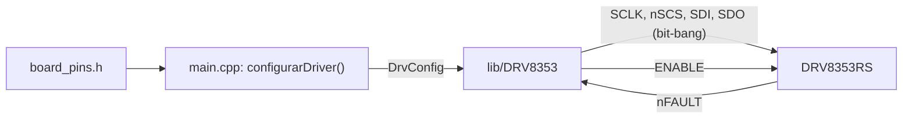
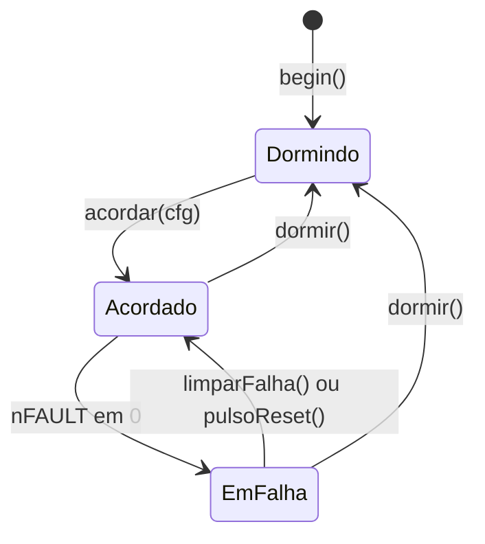

# Biblioteca DRV8353 — guia de uso e reaproveitamento da firmware_foc

## Escopo

**Cobre:** o que a biblioteca [`lib/DRV8353`](../lib/DRV8353/DRV8353.h) faz, como usá-la, todos os parâmetros de configuração e funções, as regras de segurança que o código assume e o caminho para levá-la a um projeto novo, inclusive trocando o driver antigo da `firmware_foc/`.

**Não cobre:** o dimensionamento do gate drive e da proteção para um MOSFET específico, a geração de PWM (TIM1), os halls, a malha de controle (M3 a M8 do roadmap) e a configuração interna da SimpleFOC, exceto nos pontos de contato com o driver.

> [!NOTE] Estado de validação em 2026-10-16
> Validado em bancada: leitura e escrita SPI e 300 ciclos `dormir` → `acordar` sem falha de conferência (medido com o código anterior à biblioteca, que tem a mesma lógica de transporte e conferência). A biblioteca foi gravada e usada pelo autor sem relato de problema, mas os valores de `d`, `g` e `a` não foram registrados. Não validado: qualquer configuração diferente do reset e tudo que dependa do estágio de potência soldado.

## Visão geral

A classe `DRV8353` controla o gate driver DRV8353RS (TI, SLVSDY6A) e faz quatro coisas:

1. Fala SPI com o chip por **bit-bang**, porque a ERRATA 001 (MOSI e MISO trocados na Ouroboros) impede o SPI de hardware.
2. Converte uma `DrvConfig` legível, com a unidade no nome de cada opção, nos registradores, e **relê cada um** para conferir.
3. Acorda e dorme o chip respeitando a temporização do datasheet.
4. Lê e decodifica falhas e imprime diagnóstico.



| Arquivo | Conteúdo |
|---|---|
| `lib/DRV8353/DRV8353.h` | API pública, `DrvPinos`, `DrvConfig` e os enums de opções |
| `lib/DRV8353/DRV8353_regs.h` | endereços, posições de bit, máscaras de falha e valores de reset |
| `lib/DRV8353/DRV8353.cpp` | transporte, conversão `DrvConfig` → registradores, falhas e diagnóstico |
| `include/board_pins.h` | pinos da placa; fica **fora** da biblioteca de propósito, para ela não conhecer a placa |

> [!WARNING] Nunca no laço de corrente
> Uma transação SPI leva cerca de 130 µs (valor do cabeçalho da biblioteca; meça com o comando `t`) e o período de uma malha a 20 kHz é 50 µs. Nenhuma função da biblioteca pode ser chamada de dentro dela. A falha rápida vem do `nFAULT` como GPIO ou EXTI.

## Início rápido

```cpp
#include <Arduino.h>
#include <DRV8353.h>
#include "board_pins.h"

HardwareSerial Dbg(CONSOLE_RX, CONSOLE_TX);

DRV8353 drv({ DRV_PINO_SCLK, DRV_PINO_NSCS, DRV_PINO_SDI,
              DRV_PINO_SDO,  DRV_PINO_ENABLE, DRV_PINO_NFAULT });
DrvConfig cfg;

void setup()
{
    analogReadResolution(12);
    Dbg.begin(CONSOLE_BAUD);

    drv.begin();                        // ENABLE em 0: driver dormindo
    cfg.mascarar_gdf = true;            // só em bancada, sem MOSFETs soldados
    cfg.ganho_csa    = GanhoCsa::x40;   // muda só o que precisar

    if (!drv.acordar(cfg)) {            // escreve e confere os 6 registradores
        Dbg.println(F("conferencia FALHOU"));
        return;                         // não ligue o PWM
    }
    drv.imprimirConfig(Dbg);            // prova: o que está no chip
}

void loop() {}
```

A ordem é sempre a mesma: `begin()` → preencher `cfg` → `acordar(cfg)` → conferir o retorno e o `nFAULT`. O `begin()` só ajusta os pinos (nSCS alto, SCLK baixo, ENABLE baixo) e não acorda o chip. O `DrvConfig` nasce com os valores de reset do chip, então você altera apenas o que precisar.

## Como o driver se comporta



- **O sono apaga todos os registradores.** Com o ENABLE em 0 o chip consome cerca de 20 µA e perde a configuração. Por isso todo `acordar(cfg)` reescreve e confere os seis registradores.
- **tWAKE.** O datasheet dá no máximo 1 ms entre o ENABLE subir e o chip aceitar SPI (SLVSDY6A, §7.5). A biblioteca espera 1,5 ms com `delayMicroseconds`. O `delay(1)` do Arduino pode esperar quase nada se cair logo antes do tique do SysTick, e foi a causa do `FALHOU` intermitente. O `acordar()` completo leva cerca de 3,1 ms.
- **tRST.** Um pulso de 5 a 40 µs no ENABLE limpa uma falha travada **sem** perder a configuração. `pulsoReset()` usa 20 µs. Com o ENABLE em 0 por mais de 1 ms o chip dorme.
- **`acordado()` diz só que o ENABLE está alto.** Ele continua `true` mesmo quando a conferência falha. A prova de que a configuração entrou é o retorno de `acordar()`.
- **`acordar()` e `aplicar()` limpam as falhas travadas**, porque o último registrador escrito é o 0x02 com `CLR_FLT`. Se quiser registrar a causa de uma falha, chame `lerFalhas()` antes.
- A biblioteca **nunca trava** os registradores (`LOCK` fica em 011b, destravado).

## Configuração: DrvConfig

Cada campo carrega a unidade no nome da opção. Os padrões abaixo são os valores de reset do chip.

| Campo | Opções | Padrão | Efeito |
|---|---|---|---|
| **0x02 DRIVER_CONTROL** | | | |
| `modo_pwm` | `ModoPwm::x6`, `x3`, `x1`, `Independente` | `x6` | Interface de PWM. A SimpleFOC `BLDCDriver6PWM` exige `x6` |
| `pwm1x_assincrono` | `bool` | `false` | Só no modo `x1`: retificação assíncrona |
| `ocp_desliga_tres_bracos` | `bool` | `false` | `true`: sobrecorrente desliga os três meios-braços; `false`: só o do braço em falha |
| `otw_no_nfault` | `bool` | `false` | O aviso térmico também derruba o nFAULT |
| `mascarar_gdf` | `bool` | `false` | Ignora a falha de gate drive. **Só em bancada** sem MOSFETs |
| `mascarar_gduv` | `bool` | `false` | Ignora subtensão de VCP e VGLS |
| **0x03 GATE_DRIVE_HS** | | | |
| `idrivep_hs` | `IdriveP::mA50` … `mA1000` | `mA1000` | Corrente de pico que **liga** o gate do high-side |
| `idriven_hs` | `IdriveN::mA100` … `mA2000` | `mA2000` | Corrente de pico que **desliga** o gate do high-side |
| **0x04 GATE_DRIVE_LS** | | | |
| `idrivep_ls`, `idriven_ls` | os mesmos enums | `mA1000`, `mA2000` | O mesmo, para o low-side |
| `tdrive` | `TDrive::ns500`, `ns1000`, `ns2000`, `ns4000` | `ns4000` | Quanto tempo a corrente de pico fica aplicada |
| `ocp_ciclo_a_ciclo` | `bool` | `true` | Bit CBC. Só tem efeito com `ModoOcp::Retry` |
| **0x05 OCP_CONTROL** | | | |
| `tempo_morto` | `TempoMorto::ns50`, `ns100`, `ns200`, `ns400` | `ns100` | Tempo morto inserido pelo driver |
| `modo_ocp` | `ModoOcp::Trava`, `Retry`, `SoReporta`, `Desligado` | `Retry` | Reação à sobrecorrente |
| `nivel_vds` | `NivelVds::V0_06` … `V2_00` | `V1_00` | Limiar de VDS que declara a sobrecorrente |
| `deglitch_ocp` | `DeglitchOcp::us1`, `us2`, `us4`, `us8` | `us4` | Tempo mínimo da condição antes de declarar a falha |
| `tempo_retry` | `TempoRetry::ms8`, `us50` | `ms8` | Espera antes de religar no modo `Retry` |
| **0x06 CSA_CONTROL** | | | |
| `ganho_csa` | `GanhoCsa::x5`, `x10`, `x20`, `x40` | `x20` | Ganho dos amplificadores de corrente |
| `csa_bidirecional` | `bool` | `true` | Saída repousa em VREF/2. Necessário para medir corrente alternada |
| `csa_entrada_shx` | `bool` | `false` | Entrada positiva do amplificador em SHx em vez de SPx (liga também `LS_REF`) |
| `vds_ls_ref_snx` | `bool` | `false` | VDS do low-side medido até SNx em vez de SPx |
| `nivel_sen` | `NivelSen::V0_25`, `V0_50`, `V0_75`, `V1_00` | `V1_00` | Limiar da sobrecorrente do shunt |
| `sen_ocp_desligado` | `bool` | `false` | Desliga a falha de sobrecorrente do shunt |
| **0x07 DRIVER_CONFIG** | | | |
| `autocalibracao` | `bool` | `false` | `CAL_MODE`: calibração dos CSAs pela rotina interna do chip |

Os enums longos, com os valores do SLVSDY6A (§8.6.2):

| Enum | Valores |
|---|---|
| `IdriveP` | `mA50`, `mA100`, `mA150`, `mA300`, `mA350`, `mA400`, `mA450`, `mA550`, `mA600`, `mA650`, `mA700`, `mA850`, `mA900`, `mA950`, `mA1000` |
| `IdriveN` | `mA100`, `mA200`, `mA300`, `mA600`, `mA700`, `mA800`, `mA900`, `mA1100`, `mA1200`, `mA1300`, `mA1400`, `mA1700`, `mA1800`, `mA1900`, `mA2000` |
| `NivelVds` | `V0_06`, `V0_07`, `V0_08`, `V0_09`, `V0_10`, `V0_20`, `V0_30`, `V0_40`, `V0_50`, `V0_60`, `V0_70`, `V0_80`, `V0_90`, `V1_00`, `V1_50`, `V2_00` |

No datasheet os códigos 0000b e 0001b valem 50 mA (`IdriveP`) e 100 mA (`IdriveN`); a biblioteca usa 0001b.

> [!DANGER] Padrão não é dimensionado
> Os valores de reset são seguros para bancada, mas **não** foram dimensionados para os MOSFETs do Eco Octano. Não ligue o PWM antes de dimensionar gate drive e proteção (seção "Dimensionar o gate drive").

## Funções

| Função | O que faz | Observações |
|---|---|---|
| `DRV8353(DrvPinos)` | Construtor; guarda os seis pinos | Não toca no hardware |
| `begin()` | nSCS alto, SCLK baixo, ENABLE baixo e direção dos pinos | Chame primeiro. Devolve sempre `true` |
| `acordar(cfg)` | ENABLE alto, espera 1,5 ms e chama `aplicar(cfg)` | `true` só se os seis registradores conferem. Cerca de 3,1 ms |
| `aplicar(cfg)` | Escreve e confere a configuração com o chip já acordado | Ordem: 0x03, 0x04, 0x05, 0x06, 0x07 e por último 0x02 com `CLR_FLT` |
| `registradoresDivergentes()` | Máscara do último `aplicar()`: bit n ligado = registrador 0x0n não conferiu | Use após um `acordar()` que falhou |
| `dormir()` | ENABLE baixo | **Desligue o PWM antes** |
| `acordado()` | Estado do ENABLE | Não prova que a configuração conferiu |
| `pulsoReset()` | Pulso de 20 µs no ENABLE | Limpa falha travada e mantém os registradores |
| `emFalha()` | Lê o `nFAULT` como nível (`true` com o pino em 0) | Use também após `acordar()` |
| `lerFalhas()` | Lê 0x00 e 0x01 e devolve `DrvFalhas` | Campos `status1`, `status2` e `alguma` (bit FAULT) |
| `limparFalha()` | Escreve `CLR_FLT` no 0x02 | Não resolve a causa: se persistir, o `nFAULT` cai de novo |
| `imprimirFalhas(Print&, f)` | Decodifica as falhas em texto | |
| `dump(Print&)` | Imprime os 8 registradores e marca `= reset` | |
| `imprimirConfig(Print&)` | Imprime a configuração **lida do chip** em mA, ns e V | Só com o driver acordado |
| `barramentoOk()` | Compara 0x02 a 0x07 com o reset | Só vale **antes** de configurar |
| `inicioAutoZero()`, `fimAutoZero()` | Ligam e desligam `CSA_CAL_A/B/C` (entradas em curto) | Motor parado |
| `ler(reg)`, `escrever(reg, valor)`, `escreverEConferir(reg, valor)` | Acesso direto, com 11 bits de dado | Use as constantes `DRV_REG_*` |

Decodificar uma falha, usando as máscaras de `DRV8353_regs.h`:

```cpp
const DrvFalhas f = drv.lerFalhas();
if (f.status1 & DRV_F1_VDS_OCP) { /* sobrecorrente por VDS */ }
if (f.status1 & DRV_F1_GDF)     { /* falha de gate drive */ }
if (f.status2 & DRV_F2_GDUV)    { /* subtensão de VCP ou VGLS */ }
```

## Regras de segurança

> [!DANGER] Sequência obrigatória
> 1. Desligar o PWM **antes** de baixar o ENABLE (`dormir()`).
> 2. Ligar o PWM por **último** no despertar.
> 3. Se `acordar()` devolver `false`, não ligar o PWM: o 0x02 pode estar em reset e o modo de PWM divergir do que o timer gera.
> 4. Zerar os integradores da malha de corrente ao acordar: com o chip dormindo os CSAs ficam desligados e integrar essas leituras dá coice de torque.
> 5. Nunca chamar a biblioteca dentro do laço de 20 kHz.

Despertar seguro. As três funções de PWM e de malha são do seu código e ainda não existem neste projeto:

```cpp
pwmDesligar();                      // garante o PWM parado
if (!drv.acordar(cfg)) return;      // configuração não conferiu
if (drv.emFalha())     return;      // acordar() não consulta o nFAULT
zerarIntegradores();
pwmLigar();                         // por último
```

Dormir é o inverso: `pwmDesligar(); drv.dormir();`.

## Dimensionar o gate drive

A biblioteca não escolhe os valores. O critério registrado no driver antigo (`firmware_foc/drv8353.cpp`): a corrente de IDRIVE vem da carga de gate (Qg) do MOSFET dividida pelo tempo de comutação desejado. Mais corrente comuta mais rápido e perde menos, mas aumenta dV/dt, EMI e o risco de o ringing acionar o MOSFET oposto pelo efeito Miller. Comece com corrente baixa e suba medindo a borda no osciloscópio.

Os valores herdados de `firmware_foc/drv8353_bringup.cpp`, que o sketch declara calculados para o MOSFET **CSD18535KCS**, escritos com a biblioteca:

```cpp
c.modo_pwm                = ModoPwm::x6;
c.ocp_desliga_tres_bracos = true;
c.idrivep_hs = IdriveP::mA300;   c.idriven_hs = IdriveN::mA600;
c.idrivep_ls = IdriveP::mA300;   c.idriven_ls = IdriveN::mA600;
c.tdrive     = TDrive::ns500;    c.ocp_ciclo_a_ciclo = true;
c.tempo_morto  = TempoMorto::ns200;
c.modo_ocp     = ModoOcp::Trava;
c.deglitch_ocp = DeglitchOcp::us4;
c.nivel_vds    = NivelVds::V0_20;
c.ganho_csa        = GanhoCsa::x20;
c.csa_bidirecional = true;
c.nivel_sen        = NivelSen::V0_25;
```

Leitura esperada no comando `d` com esses valores, calculada a partir das constantes do sketch antigo:

| Registrador | Valor esperado |
|---|---|
| 0x02 | `0x400` (`0x500` com `mascarar_gdf`) |
| 0x03 | `0x344` |
| 0x04 | `0x444` |
| 0x05 | `0x225` (`0x265` se `modo_ocp = ModoOcp::Retry`) |
| 0x06 | `0x280` |
| 0x07 | `0x000` |

> [!WARNING] Valores não revalidados
> Eles vêm de um sketch anterior e não foram conferidos de novo contra o SLVSDY6A nem contra a carga de gate do MOSFET. Trate como ponto de partida, não como dimensionamento. Ver Pendências.

## Calibração dos CSAs e COAST

Regras registradas no `drv8353_bringup.cpp`, que valem para qualquer implementação:

1. **Configure o ganho final antes de medir.** O offset é medido em volts na saída do amplificador e escala com o ganho. Medir com um ganho e operar com outro invalida a medida.
2. **Autocalibração (`CAL_MODE`) antes da calibração manual**, porque ela muda o offset. A manual mede e guarda o número no firmware, e medir antes de trimar guarda um valor que deixa de valer.
3. **Motor parado**, com as entradas dos amplificadores em curto.

A calibração manual com a biblioteca (ver `autoZero()` no `src/main.cpp`):

```cpp
drv.inicioAutoZero();                 // CSA_CAL_A/B/C ligados
delay(5);                             // acomodação
const int a = analogRead(PINO_LSCS_A);
const int b = analogRead(PINO_LSCS_B);
const int c = analogRead(PINO_LSCS_C);
drv.fimAutoZero();                    // entradas de volta aos shunts
```

Com `analogReadResolution(12)` e VREF de 3,3 V, o esperado é cerca de 1,65 V (2048 contagens) nos três canais.

A biblioteca ainda não tem função própria para COAST (todos os MOSFETs em Hi-Z). Com o acesso direto:

```cpp
const uint16_t dc = drv.ler(DRV_REG_DRIVER_CONTROL);
drv.escreverEConferir(DRV_REG_DRIVER_CONTROL, dc | DRV_DC_COAST);    // liga
drv.escreverEConferir(DRV_REG_DRIVER_CONTROL, dc & ~DRV_DC_COAST);   // desliga
```

A rotina de autocalibração do sketch antigo (`CAL_MODE = 1`, pulso em `CSA_CAL_x` por 200 µs, volta a `CAL_MODE = 0`) não foi portada. O campo `autocalibracao` só liga o bit.

## Levar a biblioteca para um projeto novo

1. Parta do `platformio.ini`, de `boards/` e de `tools/` deste repositório, não do `.ini` da `firmware_foc/`. Cada linha `[G491]` evita uma falha distinta (tabela de armadilhas no [README](../README.md)).
2. Copie `lib/DRV8353/` inteira. Ela só depende do núcleo Arduino (`Arduino.h` e `Print`); não há `lib_deps`.
3. Copie `src/clock_config.cpp`. Sem ele o clock não chega a 170 MHz e o ADC devolve zero.
4. Crie o `board_pins.h` com as seis constantes abaixo e passe-as ao construtor.
5. No `setup()`: `analogReadResolution(12)` e o console na USART1 (PB6 e PB7) pela FTDI. Nunca use `Serial` nem a USART2: o TX dela é o PA2, que aqui é o `LSCS_A`.
6. No hardware: pull-up de 4,7 kΩ no SDO (pino 29) e o jumper J7 do nFAULT na posição da Artemis (errata menores do README).
7. No Windows, o caminho do projeto não pode ter acento.
8. Valide com a tabela da seção "Verificação na bancada" antes de qualquer outra coisa.

| Constante | Pino do MCU | Pino do CI | Função |
|---|---|---|---|
| `DRV_PINO_SCLK` | PC10 | 31 | Clock do SPI |
| `DRV_PINO_NSCS` | PC9 | 32 | Seleção de chip, ativo em 0 |
| `DRV_PINO_SDI` | PC11 | 30 | Dados **para** o driver (a rede se chama MISO: errata) |
| `DRV_PINO_SDO` | PC12 | 29 | Dados **do** driver, dreno aberto |
| `DRV_PINO_ENABLE` | PD2 | 33 | Acorda (1) ou dorme (0) o driver |
| `DRV_PINO_NFAULT` | PB10 | 28 | Falha com o pino em 0 |

Quando a ERRATA 001 for corrigida na placa, só as linhas de `SDI` e `SDO` mudam no `board_pins.h`. A biblioteca continua em bit-bang.

## Reaproveitar a firmware_foc

### O que há na pasta

| Arquivo | O que é | Situação |
|---|---|---|
| `drv8353.h` e `drv8353.cpp` | Driver antigo, com `SPIClass` (SPI de hardware) | **Não compila**: depende de um cabeçalho de registradores (`DRV_FS1_*`, `DRV_ADDR_SHIFT`) que não existe em nenhum arquivo do repositório. Além disso, o SPI de hardware não funciona nesta placa. Substitua pela biblioteca |
| `drv8353_bringup.cpp` | Sketch isolado: acorda, configura, autocalibra e mede offsets | SPI de hardware (não funciona). Vale como **referência** de sequência e de valores |
| `inline_bringup.cpp` | Bring-up da corrente inline com SimpleFOC (etapa 1 desarmado, etapa 2 em modo tensão) | Não usa o driver por SPI: sobe o ENABLE na mão e deixa o chip nos valores de reset |
| `platformio_duas_envs.ini` | Dois ambientes, `inline` e `lowside`, com `-D CS_MODE_*` | Não tem as correções `[G491]` (usa `board = nucleo_g491re` e `upload_protocol = stlink`). Use só como modelo da estrutura |

### Trocar o driver antigo pela biblioteca

| `firmware_foc/drv8353.h` | `lib/DRV8353` |
|---|---|
| `DRV8353(SPI, cs, enable, nfault)` | `DRV8353({sclk, nscs, sdi, sdo, enable, nfault})` |
| `begin(cfg)` | `begin()`; a configuração vai em `acordar(cfg)` |
| `enable()` | `acordar(cfg)` |
| `disable()` | `dormir()` |
| `isEnabled()` | `acordado()` |
| `readReg(addr)` | `ler(reg)` |
| `writeReg(addr, dado)` (escreve e relê) | `escreverEConferir(reg, valor)` |
| `readFaults()` com campos booleanos | `lerFalhas()` e as máscaras `DRV_F1_*` e `DRV_F2_*` |
| `faultPinActive()` | `emFalha()` |
| `clearFaults()` | `limparFalha()` |
| `calibrateCSA(us)` | `inicioAutoZero()`, leitura do ADC, `fimAutoZero()` |
| `dumpRegisters(Stream&)` | `dump(Print&)` e `imprimirConfig(Print&)` |

Correspondência dos campos de `DrvFaults`: `any` → `alguma`; `vds_ocp` → `DRV_F1_VDS_OCP`; `gate_fault` → `DRV_F1_GDF`; `uvlo` → `DRV_F1_UVLO`; `overtemp` → `DRV_F1_OTSD`; `overtemp_warn` → `DRV_F2_OTW`; `cp_uv` → `DRV_F2_GDUV` (o bit se chama GDUV no datasheet); `sense_oc` → `DRV_F2_SA_OC`, `DRV_F2_SB_OC` e `DRV_F2_SC_OC`.

> [!WARNING] Três comportamentos mudam na troca
> 1. **OCP_ACT.** O driver antigo sempre ligava `OCP_ACT` (a sobrecorrente desliga a ponte inteira, o que o próprio comentário recomenda para veículo). Na biblioteca o padrão é `false`. Para manter o comportamento antigo: `cfg.ocp_desliga_tres_bracos = true`.
> 2. **nFAULT após acordar.** O `enable()` antigo devolvia `false` se o `nFAULT` estivesse em 0 depois de configurar. O `acordar()` novo não consulta o pino: chame `emFalha()` em seguida. Uma falha que ocorre durante o despertar não gera borda nova para a interrupção.
> 3. **Modo do pino nFAULT.** O antigo usava `INPUT_PULLUP`. A biblioteca usa `INPUT` e depende do pull-up externo da Artemis (jumper J7).

### Pontos de contato com a SimpleFOC

- **Modo 6x.** `BLDCDriver6PWM` exige `cfg.modo_pwm = ModoPwm::x6`.
- **Tempo morto em um só lugar.** Segundo o comentário do driver antigo, o tempo morto do DRV soma com o `driver.dead_zone` da SimpleFOC, e somar os dois distorce a corrente em baixa modulação. Escolha um e zere o outro. O `inline_bringup.cpp` usa `dead_zone = 0.025f`.
- **ADC em 12 bits.** A SimpleFOC converte a contagem crua assumindo a resolução de `_ADC_RESOLUTION`. Sem `analogReadResolution(12)` a corrente sai errada por um fator inteiro.
- **Ordem no despertar.** O `driver.init()` da SimpleFOC já faz o timer gerar PWM. Para respeitar "PWM por último", chame `drv.acordar(cfg)` e confira **antes** dele.
- **Ordem na falha.** O `loop()` do `inline_bringup.cpp` baixa o ENABLE antes de `motor.disable()`. Inverta: `motor.disable(); drv.dormir();`.
- **Linhas do platformio.ini.** `lib_archive = no` é obrigatório com a SimpleFOC, mais os `lib_deps` do `.ini` da pasta. Sem o `lib_archive = no` o linker descarta construtores estáticos e a placa trava sem mensagem.

Pinos do `inline_bringup.cpp` que **ainda não estão** no `board_pins.h` e não passaram pela verificação com ponteira:

| Sinal | Pinos |
|---|---|
| PWM fase A (alto / baixo) | PA8 / PA11 |
| PWM fase B (alto / baixo) | PA9 / PA12 |
| PWM fase C (alto / baixo) | PA10 / PB1 |
| Halls A, B, C (TIM3) | PC6, PC7, PC8 |

O LED também diverge: `PC14` no `inline_bringup.cpp` e `PA0` (`PINO_LED_STATUS`) no `board_pins.h`. As correntes inline (PC0, PA7, PB13), o ENABLE (PD2), o nFAULT (PB10) e o nSCS (PC9) coincidem nos dois.

### Roteiro

1. Monte o `platformio.ini` novo a partir do deste repositório e acrescente as linhas da SimpleFOC. Use a estrutura `[common]` + `extends` do `platformio_duas_envs.ini` se quiser os ambientes `inline` e `lowside`.
2. Copie `lib/DRV8353/`, `include/board_pins.h` e `src/clock_config.cpp`.
3. Verifique com ponteira e acrescente ao `board_pins.h` os pinos de PWM e halls; resolva a divergência do LED.
4. Valide o driver com o `src/main.cpp` de bancada deste repositório (tabela abaixo) **antes** de trocar para o código do FOC.
5. Use o `inline_bringup.cpp` como `src/main.cpp` e troque o ENABLE manual por `drv.begin()` e `drv.acordar(cfg)`, com `ocp_desliga_tres_bracos = true`, `modo_pwm = x6` e o tempo morto definido em um só lado.
6. Inverta a ordem na falha (`motor.disable()` antes de `drv.dormir()`).
7. Rode a etapa 1 (nada energizado) e só depois a etapa 2, com tensão baixa e a roda livre, como o próprio sketch exige.

## Verificação na bancada

O `src/main.cpp` deste repositório é a bancada de testes. Os comandos do console (porta da FTDI, 115200):

| Comando | Esperado |
|---|---|
| `d` | 0x03 = `0x3FF`, 0x04 = `0x7FF`, 0x05 = `0x16D`, 0x06 = `0x283`, 0x07 = `0x000`, cada um marcado `= reset`. 0x02 = `0x000`, ou `0x100` com o GDF mascarado |
| `g` | A configuração em mA, ns e V igual à de `configurarDriver()` |
| `r` | `ciclos: 30  falhas: 0` |
| `a` | SOA, SOB e SOC perto de 1,65 V |
| `s` | Sem falha, ou `GDF` e `VGS_Lx` quando MOSFETs e shunts não estão soldados (comportamento correto do driver) |
| `t` | Custo de um quadro SPI em µs |
| `w` e `z` | Acorda com `conferencia: OK` e dorme |
| `p` e `c` | Pulso tRST e `CLR_FLT` |

## Problemas comuns

| Sintoma | Causa provável | O que fazer |
|---|---|---|
| `conferencia: FALHOU` e `registradores divergentes: 0x0n` | Espera de tWAKE curta, pull-up do SDO ausente ou ligação SDI e SDO errada | Confira o pull-up de 4,7 kΩ no SDO e rode `r`. A lista diz quais registradores divergem |
| Todos os registradores leem `0x7FF` | Driver dormindo ou sem alimentação. Só o 0x04 deveria ler `0x7FF` | Aperte `w` e confira ENABLE e VM |
| 0x02 lê `0x100` | `mascarar_gdf` ligado | Esperado em bancada sem estágio de potência |
| `GDF` e `VGS_Lx` ativos | MOSFETs e shunts não soldados | Comportamento correto do driver |
| `analogRead` devolve 0 | Falta o `clock_config.cpp` (clock do ADC) | Copie o arquivo |
| Auto-zero lê cerca de 0,41 V | Falta `analogReadResolution(12)` | Acrescente no `setup()` |
| `nFAULT` instável | Jumper J7 fora da posição da Artemis. O LED indicador não prova o nível do pino | Confira o jumper e meça o pino |

## Referências

- Datasheet DRV835x, SLVSDY6A (TI): §7.5 Electrical Characteristics (tWAKE, tRST, ISLEEP), §8.5.1.1 SPI e §8.6 mapa de registradores (Tabelas 14 a 19, registradores de controle).
- [README](../README.md): ERRATA 001, errata menores, procedimento de bring-up e armadilhas do PlatformIO.
- `firmware_foc/drv8353_bringup.cpp` e `firmware_foc/inline_bringup.cpp`: origem dos valores de exemplo e dos pinos de PWM e halls.

## Pendências

- [ ] [PENDENTE: registrar em bancada os valores de `d`, `g` e `a` da biblioteca; a validação de 2026-10-16 só tem o registro dos 300 ciclos de `r`]
- [ ] [PENDENTE: carga de gate (Qg) e Rds(on) do CSD18535KCS, a buscar no datasheet do componente, para dimensionar IDRIVE, TDRIVE e VDS_LVL; os valores de exemplo vieram do sketch antigo]
- [ ] Validar na bancada a configuração de exemplo e comparar o `d` com a tabela esperada, antes de qualquer PWM
- [ ] [PENDENTE: valor real do shunt inline; o `inline_bringup.cpp` usa 1 mΩ (declarado placeholder), o `platformio_duas_envs.ini` e o `drv8353_bringup.cpp` usam 3 mΩ. Conferir no esquemático]
- [ ] [PENDENTE: versão da SimpleFOC; o `inline_bringup.cpp` cita 2.3.4 e o `platformio_duas_envs.ini` pede `^2.4.0`]
- [ ] [PENDENTE: confirmar na SimpleFOC em uso se `disable()` do `BLDCDriver6PWM` sem pino de enable realmente para o PWM antes do `dormir()`]
- [ ] Decidir se `acordar()` passa a consultar o `nFAULT`, como fazia o `enable()` antigo
- [ ] Definir o padrão de `ocp_desliga_tres_bracos` para o veículo (`true`, como no driver antigo)
- [ ] Portar do `drv8353_bringup.cpp` a rotina de autocalibração (`CAL_MODE`) e funções de COAST e BRAKE
- [ ] Verificar com ponteira e acrescentar ao `board_pins.h` os pinos de PWM e halls; resolver o LED (`PC14` x `PA0`)
- [ ] Mover `firmware_foc/` e `testes/` para uma pasta de referência (proposta aguardando decisão)
- [ ] Depois de corrigir a ERRATA 001 na placa, trocar `SDI` e `SDO` no `board_pins.h` e avaliar o SPI de hardware

## Histórico de revisões

| Versão | Data | Alteração |
|---|---|---|
| 1.0 | 2026-10-16 | Versão inicial: uso, configuração, funções, regras de segurança, calibração e roteiro de reaproveitamento da `firmware_foc/` com a biblioteca |
